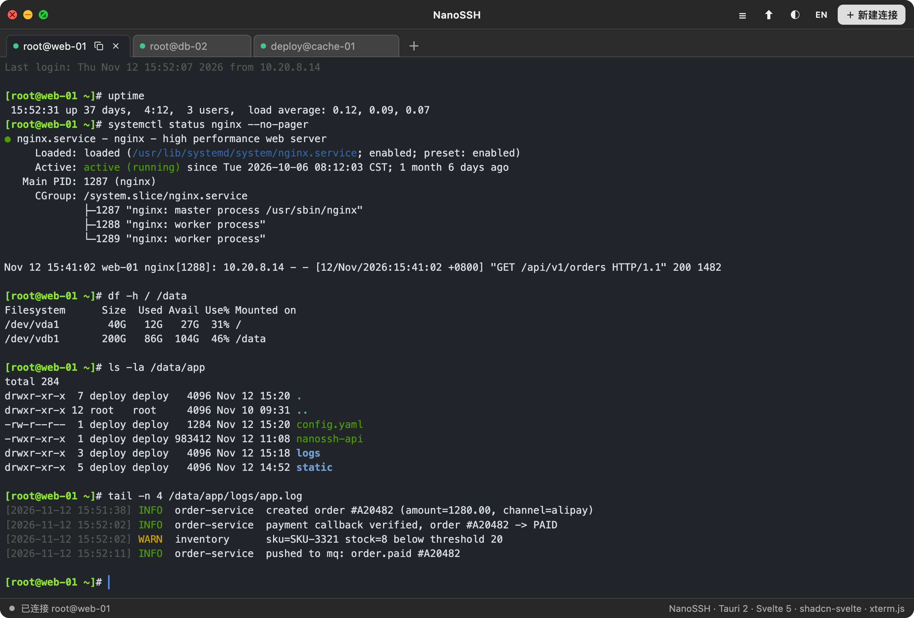

# NanoSSH

跨平台多页签 SSH 客户端。纯 Rust 实现 SSH 协议栈，不依赖系统 `ssh` 命令，Windows / macOS / Linux 三平台同一套代码。

**下载**：[最新 Release](https://github.com/Alivop/nanossh/releases/latest)（macOS arm64 `.dmg` · Windows x64 `.exe` / `.msi`）· 开源协议 [MIT](LICENSE)



| 层 | 技术 |
|---|---|
| 桌面外壳 | Tauri 2（系统 WebView，不捆绑 Chromium，安装包约 5–15 MB） |
| SSH 后端 | `russh` 0.64（密码 / 私钥认证、PTY、交互式 shell、窗口尺寸同步） |
| 本地终端 | `portable-pty` 0.9（跨平台 PTY，启动本机登录 shell） |
| 终端渲染 | `xterm.js` 6 + `addon-fit` |
| 前端 | **Svelte 5（runes + TS）+ Vite 7 + Tailwind CSS v4 + shadcn-svelte**（组件源码内联在 `src/lib/components/ui/`） |
| 配置存储 | Rust 侧 **AES-256-GCM 加密文件**（应用数据目录），主题与语言仍存 `localStorage` |
| 页签恢复 | 打开的页签（kind / 配置 / 标题 / 顺序 / 活动页签）持久化在 `localStorage["nanossh-tabs"]`，**密码一律不落盘**；重启后恢复页签，**只自动连接活动页签**，其余为「待连接」态（黄点），**切换到该页签或按 Enter 时自动连接**；无凭据的恢复为页内密码输入态 |
| 多语言 | **中文（默认）/ English**，标题栏 `EN` / `中` 按钮即时切换，`localStorage` 记住选择；实现见 `src/lib/i18n.svelte.ts`（**中文原文即 key**，英文查词典，`{name}` 插值，无第三方依赖） |

## 核心交互

| 操作 | 结果 |
|---|---|
| 标题栏 | 居中展示应用名 `NanoSSH`；左上角是三颗**自绘**交通灯（红 ✕ / 黄 − / 绿 双向箭头，符号常显、同色系深色；圆点与符号画在**同一个 12×12 SVG** 里共用一次栅格化，保证符号严格同心），窗口为无边框 + 透明背景，**圆角 12px 由 CSS 画**，最大化时自动收回 |
| **拖动 / 缩放窗口** | 标题栏空白处可拖动（`data-tauri-drag-region`）；四边与四角可缩放，窗口最小 760×500 |
| **双击标题栏** | **最大化 / 还原**（自实现：Tauri 内置双击要求按下与抬起坐标完全一致，触控板轻微移动就失效；改为自己接管并在捕获阶段拦掉内置逻辑，避免两次切换互相抵消）。双击按钮等可交互元素不触发 |
| **首页（无页签时）** | 显示「还没有会话」+ 新建入口，下面只列**最近用过的 3 条连接**（按 `localStorage["nanossh-recent-conns"]` 里记录的打开时间倒序；历史不足 3 条时按保存顺序补齐，点一下即连）；再下面是操作提示，含**终端字号快捷键**（⌘= / ⌘+ 放大、⌘- / ⌘_ 缩小、⌘0 重置） |
| **拖动页签** | **拖动排序**：按住页签左右拖（移动超过 5px 才算拖动，不影响单击切换 / 双击克隆），插入位置显示竖线指示条，松开落位并持久化；页签多到滚动时贴边自动滚；拖动中按 `Esc` 放弃。指针自实现（Tauri dragDrop 接管下 HTML5 DnD 在 macOS 不可靠） |
| **双击页签** | **克隆整个会话**：用同一份连接配置新开一个页签，标题是 **原标题 + `副本N`**（`root@host 副本1`、`root@host 副本2` … 编号全局累加；克隆副本时自动剥掉旧编号，hover 页签提示克隆来源） |
| **鼠标悬停在页签上** | 显示 `⧉` 按钮，点击复制该页签标题；右键菜单也有「复制标题」 |
| **右键页签** | 克隆会话（复制页签）/ 编辑连接 / 文件传输…（SFTP）/ 重新连接（复制标题、关闭页签已有悬停按钮，不重复放菜单） |
| **右键终端 / 其他区域** | 终端内右键：复制（无选区时置灰）/ 粘贴；输入框保留系统编辑菜单；其余空白区域屏蔽 WebView 默认菜单 |
| **连接失败后按 Enter** | 在原终端里重新连接，不用关掉页签重开 |
| **网络断开 / 恢复** | 系统断网时，已连接的 SSH 页签立即转「待重连」并在终端提示；网络恢复后在终端与状态栏提示**按 Enter 重新连接**，按 Enter 即断开旧会话按原配置重连。本地终端不受影响 |
| **新建连接弹窗 → 测试** | 只做 TCP + 密钥交换 + 认证，成功后立即断开，不创建页签、不留会话，10 秒超时（按钮「测试」，主按钮为「保存并连接」/「保存」）。**测试结果显示在底部按钮左侧的固定位置**（成功灰字 `✓ …`、失败红字 `✗ …`），最多两行、超长内容鼠标悬停看全文；不新增一行，弹窗高度不跳动 |
| **密码框右侧眼睛图标** | 切换密码明文 / 密文显示；每次重新打开弹窗都会复位为密文 |
| **标题栏 ☰** | 打开「已保存的连接」**管理面板**：**按分组折叠展示**，可搜索（名称 / 主机 / 用户名 / 端口 / 私钥 / **分组名**）、**回车直连第一条**；条目可**上下拖动排序**（在本组内换位、随加密文件持久化；搜索过滤中禁用），**新保存的连接自动排在最前**。每行常显 **复制 / 编辑 / 删除** 三个图标。复制图标会立即生成一份新连接（标题加「副本」、**继承原分组**）并打开编辑弹窗。☰ 不显示数量角标 |
| **悬停页签栏 ＋** | ＋ **紧跟在最新打开的页签右边**（在列表内部随页签一起排列）。悬停打开**另一个独立**的「快捷新建」面板：内容与管理面板不同——**不显示任何说明文字**，顶部是「新建 SSH 连接」与「本地终端」两个动作，下面是精简的已保存会话列表，点击即连、同样可搜索。面板右缘与 ＋ 对齐、向下展开，**点击 ＋ 直接新建本地终端** |
| **标题栏 ⬆ / 右键 SSH 页签 → 文件传输** | 打开 **双栏目录浏览器**：左「本地」右「远程」，**远端起始目录跟随终端里 cd 的位置**（优先 shell 经 OSC 1337 上报的目录；没有 shell integration 时在同一条 SSH 连接上开 exec 通道，用 `/proc` 定位该 pty 的会话首进程读取真实 cwd，不向终端写任何字符；探测不到回落默认目录，如非 Linux 远端），本地取上次目录 / 本地终端 cwd；点击目录进入、`↑` 上级、`⌂` 默认目录、`⟳` 刷新；路径框可直接输入绝对路径回车跳转；选中文件后「上传 →」/「← 下载」，上传/下载点击后立即入队（不阻塞界面），进度与结果在悬停面板里查看 |
| **双栏排序与搜索** | 每栏都有**搜索框**（按文件名过滤当前目录，`Esc` 清空，无匹配时提示）与**列头排序**：点「名称 / 大小 / 修改时间」排序、再点一次换方向（文件与目录**混排**、严格按所选列排，名称比较是数字感知的 `a2 < a10`，修改时间缺失显示 `—` 且按 0 参与排序）；**两侧各自记住排序、互不同步**，存 `localStorage["nanossh-sftp-sort"]`（`{local:{…}, remote:{…}}`，兼容旧版单份格式），行内新增修改时间列（随界面语言格式化） |
| **拖文件到窗口 = 直接上传** | 从访达把文件拖进窗口任意位置：拖入时全窗显示「松开鼠标上传 N 个文件 → 目标目录」虚线提示；松开即上传到**远端当前目录**（SFTP 浏览器没开时，只要活动页签是已连接的 SSH 会话就自动打开再传）。目录会被跳过并提示（暂不支持递归上传）；没有已连接 SSH 会话时给出错误提示。macOS 的 HTML5 drop 被 Tauri 接管，走的是 `tauri://drag-*` 事件（`src/lib/stores/dnd.svelte.ts`），Rust 侧配套 `path_kinds` 命令判断文件/目录 |
| **悬停标题栏 ⬆** | 打开**后台传输**面板：上传/下载都在 Rust 侧独立 task 里跑，关掉文件浏览器也不中断；每项显示逐文件进度，可**暂停 / 继续**、**取消并删除**，已完成的可从列表移除。列表**最多保留 20 条**（进行中的任务不会被挤掉）并**加密缓存到本机**，重启后历史仍在，未跑完的标记为「已中断」。仍有任务进行中时 ⬆ 右上角有状态小圆点 |
| **本地终端** | 用 `portable-pty` 启动本机登录 shell（Unix `$SHELL` / Windows `COMSPEC`），与 SSH 页签共用读写、尺寸同步与关闭链路；shell 退出后按 Enter 可重新打开 |
| **点击未保存密码的连接** | 不弹连接对话框，直接开页签，在页内输入密码即可连接 |
| **标题栏 `EN` / `中`** | 切换界面语言（中文 ↔ English）并记住选择；**切屏即时生效**，正在打开的弹窗、面板、页签提示一起换语言。用户数据（连接标题、自定义分组名）不翻译 |
| **顶部系统菜单** | Rust 侧自建（`src-tauri/src/menu.rs`），中英两套随界面语言整份重建：文件（新建连接 ⌘N / 本地终端 ⌘T / 关闭页签 ⌘W）· 编辑（撤销/重做/剪切/复制/粘贴/全选）· 视图（明暗主题 ⇧⌘D / 切换语言 ⇧⌘L / 字号 / 光标样式 / 文件浏览器 ⇧⌘O / 全屏）· 窗口（最小化/缩放）；没有 Reload、开发者工具、后退前进等废项 |
| **终端字号** | ⌘= / ⌘+ 放大、⌘- / ⌘_ 缩小（每步 1px，范围 9–28px）、⌘0 重置为 13px；只对终端生效，**同步所有已打开页签**并按新尺寸重排（onResize 推 cols/rows 给远端），选择记在 `localStorage["nanossh-font-size"]`，新页签沿用 |
| **终端光标** | 默认**竖线**（2px 高亮细线，`cursorStyle: bar` + `cursorWidth: 2`），不再是整格涂满的方块（中文字体下会显得特别宽）；「视图 → 光标样式」可在**竖线 / 方块 / 下划线**间切换，当前项打勾，切换立即作用于所有已打开页签并记在 `localStorage["nanossh-cursor-style"]`；窗口失焦时光标转为空心框 |
| **终端回滚不被打断** | 往上翻历史时按 Ctrl/Option/Command（开着中文输入法时任意按键会被 WebView 标记成 IME 事件 keyCode 229）不会像 xterm 默认行为那样把视口拽回底部——已关 `scrollOnUserInput`，改为**真正产生输入（键入/粘贴）时才回底部**，往上翻历史选文字做 Cmd+C 复制不再跳走 |

### 文件浏览器的默认目录（零侵入）

**连接建立后不会向终端写入任何字符**，也不会修改远端 shell 的 `PROMPT_COMMAND` / `precmd_functions`，因此登录时终端保持干净、不会出现自动执行的命令。

- **远端**：打开 `⬆` 时 `sftp_list(id, "")` 由后端 `canonicalize(".")` 返回 SFTP 会话的登录默认目录（通常是 home），`⌂` 可随时回到这里。
- **本地**：默认取上次打开过的目录（`localStorage["nanossh-sftp-local-dir"]`），首次回落到本机 HOME。
- **可选被动增强**：如果 shell **自己**装了 OSC 1337 上报（例如 iTerm2 shell integration、部分 zsh 配置），`term.parser.registerOscHandler(1337)` 会把它记到 `tab.cwd`，浏览器优先用这个更精确的位置；应用本身不注入、不探测、不改写用户 shell。
- 两侧路径框都可直接输入绝对路径回车跳转；`↑` 上级、`⌂` 默认目录、`⟳` 刷新。代价是**不再自动跟随交互终端里 `cd` 之后的位置**。


## 连接分组

连接配置多了一个 `group` 字段，只影响展示与整理，**存储格式不变**——它就在 `profiles_save(json)` 那份 JSON 里，跟着 AES-256-GCM 一起加密。

- **旧数据零迁移成本**：读盘时 `normalizeGroup()` 把缺失 / `null` / 纯空白的 `group` 统一补成 `未分组`；只有真的发生补齐时才回写一次加密文件。
- **管理面板按分组分区**：每组一个可点击的组头（折叠箭头 + 组名 + 条数），点一下折叠 / 展开；折叠状态只存在内存（`profilesState.collapsed`），重启后回到全部展开。
- **排序**：自定义分组按 `localeCompare("zh-CN")` 的拼音序，「未分组」恒排最后——避免它混在业务分组中间。
- **连接弹窗的「分组」**：用输入框 + `datalist` 候选，既能点选已有分组，也能直接敲一个新名字；留空即归到「未分组」。
- **搜索命中分组名**：输入 `生产` 会把「生产环境」整组留在结果里，方便整组操作。
- **复制连接继承分组**：`duplicateProfile()` 会带上原 `group`，不会把副本丢进「未分组」。

## 连接的保存、加密与编辑

- 新建连接时默认勾选 **保存到连接列表**。配置由 Rust 侧用 **AES-256-GCM** 加密后写入应用数据目录的 `profiles.enc`，**前端不再往 localStorage 写任何凭据**。
- 32 字节随机密钥单独保存在同目录 `secret.key`（Unix 下权限 `0600`，目录 `0700`）；密文格式为 `base64(nonce || ciphertext)`。密钥文件丢失后旧配置无法解密，应用会明确报错而不是静默清空。
- 旧版本留在 `localStorage["nanossh-profiles"]` 的明文配置，首次启动时自动迁移到加密文件并删除旧数据。
- **密码默认不保存**。勾选「记住密码」才随配置一起加密落盘。
- 未保存密码的连接点击后：直接打开页签，页内显示密码输入框（同样带眼睛图标），输入回车即连；可勾选「记住密码（加密保存到此连接）」。取消则关闭该页签。密码默认只在内存中用于本次连接。
- 右键页签 → **编辑连接**，改完点「保存并重连」即更新配置与已保存的记录，并**立即断开旧会话、按新配置自动重连**（失败态/待输密码态同样直接重建）。
- 两个下拉面板**互不共用**：`#profiles-panel`（☰ 管理）与 `#quick-panel`（＋ 快捷）各有独立的搜索框、列表内容与开关逻辑。打开任何连接弹窗前都会先收起两个面板，弹窗层级更高，不会再被挡住看不到。
- 管理面板每行常显 **复制 / 编辑 / 删除** 三个图标（**没有「连接」图标**，点击条目本身即连接）。删除需二次点击确认；凭据状态放在条目 hover 提示里。快捷面板的条目只有名称与目标，没有任何操作图标。
- 点「复制」会立即复制出一条新连接（新 id、标题加「副本」，凭据一并复制并加密保存），同时打开「复制并编辑连接」弹窗，改完点「保存」即可；直接取消也会保留这条副本，可再删除。

## 传输记录的持久化

- **入队与终态（完成 / 失败 / 取消）立即写盘**（刚发起就退出应用也不丢记录、重启后不会误判为进行中），「暂停 / 继续 / 删除」走 250ms 防抖合并；**进度事件不写盘**，避免每 2% 就加密一次文件。
- 与连接配置共用 `secret.key`，记录单独 AES-256-GCM 加密写入同目录的 `transfers.enc`（Unix 权限 `0600`）。快照只存展示所需字段，不含逐文件 `outcomes`，也不含密码。
- 列表**最多 20 条**：超出时从最旧的「已结束」记录开始淘汰，`running` / `paused` 的任务不会被自动删掉。
- 启动时 `transfers_load()` 解密恢复；后端 job 只存活在进程内，所以恢复时把 `running` / `paused` 统一改成 `interrupted`（红色进度条，文案「应用重启，传输未完成」），**不会续传，也不会留下假进度**。hover 任务卡片可看到发起时间。
- 保存失败会在控制台告警，不影响正在进行的传输。

## 开发环境

- Node.js ≥ 20 与 pnpm
- Rust stable（本机验证版本：rustc 1.97）
- Windows：WebView2 Runtime（Win10/11 通常已内置）、MSVC 生成工具
- macOS：`xcode-select --install`
- Linux：`webkit2gtk-4.1`、`libayatana-appindicator3-dev`、`librsvg2-dev`、`build-essential`

## 运行

```bash
pnpm install
pnpm tauri:dev        # 启动桌面窗口 + Vite 热更新（1420 端口）
```

生产构建：

```bash
pnpm tauri:build      # 构建当前平台安装包，产物在 src-tauri/target/release/bundle/
pnpm build            # 只构建前端（Svelte 编译 + Tailwind + 打包）
pnpm exec svelte-check --tsconfig ./tsconfig.json   # 类型检查（当前 0 error / 0 warning）
cd src-tauri && cargo check        # 只检查 Rust 侧
cd src-tauri && cargo test --lib   # 单元测试
```

SFTP 端到端自测（macOS）：把 TCP 连接桥接到本机 `/usr/libexec/sftp-server` 后，带 `NANOSSH_SFTP_E2E=127.0.0.1:端口` 与 `NANOSSH_SFTP_ROOT=目录` 运行 `cargo test --lib sftp_`；包含上传 200 KB 逐字节回读、目录列举 + 下载 137 KB 逐字节回读，以及「不覆盖同名文件」分支。未设置环境变量时这两个用例自动跳过。

`bundle.targets` 里刻意排除了 `dmg`：macOS 默认只产 `.app`，不依赖挂载临时磁盘映像，沙箱 / CI 环境也能成功；Windows / Linux 仍按 NSIS / MSI / AppImage / deb / rpm 出包。本地桌面环境如需 `.dmg`：

```bash
pnpm dist:mac:dmg
```

> 受限环境下 `bundle_dmg.sh` 可能因无法挂载磁盘映像而失败，这不影响 `.app` 产物，也不影响应用运行。

仓库已配置 GitHub Actions（`.github/workflows/build.yml`）：推送到 `main` 即在 macOS / Windows / Linux 三个 runner 上构建，产物在 Actions 页面的 **Artifacts** 里下载（Windows 出 `.exe` + `.msi`，macOS 出 `.app` + `.dmg`，Linux 出 `.AppImage` + `.deb`）：

| 平台 | 产物 |
|---|---|
| macOS | `NanoSSH.app`（可选 `.dmg`） |
| Windows | `.exe`（NSIS）/ `.msi` |
| Linux | `.AppImage` / `.deb` |

## 目录结构

```
.
├── docs/screenshot.png              # README 里的界面截图（仅文档用，不参与构建）
├── index.html                       # 只有 <div id="app"> 挂载点，界面全在 Svelte 里
├── components.json                  # shadcn-svelte 的别名 / Tailwind / 图标配置
├── svelte.config.js · tsconfig.json · vite.config.ts
├── src/
│   ├── main.ts                      # 挂载 App + 订阅 4 个 Rust 事件后转交 store
│   ├── App.svelte                   # 布局骨架与浮层装配
│   ├── app.css                       # Tailwind 入口 + shadcn 主题变量 + 窗口骨架样式
│   └── lib/
│       ├── types.ts                  # Profile / Tab / Transfer / DirListing 等契约（字段与 serde 对齐）
│       ├── utils.ts                  # cn() 类名合并 + shadcn 组件需要的 WithElementRef 等工具类型
│       ├── actions.ts                # 「点已保存连接」这类跨组件动作
│       ├── panels.ts                 # ☰ / ＋ / ⬆ 三个浮层面板的开关、定位与悬停防抖
│       ├── stores/                   # 状态与副作用，全部 .svelte.ts（runes）
│       │   ├── ui.svelte.ts          # 主题、浮层、弹窗、右键菜单、toast、状态栏
│       │   ├── profiles.svelte.ts    # 加密配置读写、分组归一化/排序/搜索、复制
│       │   ├── tabs.svelte.ts        # 页签状态机 + xterm 实例池 + SSH 数据流桥接
│       │   ├── browser.svelte.ts     # 双栏目录浏览、路径跳转、选择与传输入队
│       │   └── transfers.svelte.ts   # 后台传输队列、20 条上限、加密缓存恢复
│       └── components/
│           ├── TitleBar · TabBar · TerminalView · EmptyState · StatusBar
│           ├── ProfilePanel · QuickPanel · ConnectDialog · PasswordPrompt
│           ├── SftpBrowser · DirPane · TransferPanel · ContextMenu · Toasts
│           └── ui/                   # shadcn-svelte 生成的组件源码（button/input/dialog/…）
├── src-tauri/
│   ├── src/lib.rs                    # SSH / 本地 PTY 会话池 + 加密存储 + SFTP，共 17 个 Tauri command（含 3 个后台传输控制与 2 个加密记录读写）
│   ├── src/main.rs                   # 入口
│   ├── capabilities/default.json     # 窗口控制 / 事件权限
│   ├── icons/                        # 各平台图标（由 tauri icon 生成）
│   ├── tauri.conf.json               # 无边框窗口、打包图标、devUrl
│   └── Cargo.toml
└── .legacy-v1/                       # 重写前的原生 JS 前端，仅作行为参照，不参与构建
```

## 数据通道

```
键盘 → xterm onData → base64 → ssh_write(id, data) → mpsc → channel.data_bytes → 远端
远端 → ChannelMsg::Data → base64 → emit("ssh-data") → xterm.write(Uint8Array)
尺寸 → xterm onResize / fit() → ssh_resize → channel.window_change
测试 → ssh_test(cfg) → connect + authenticate + disconnect（不申请 PTY，不入会话表）
本地 → local_open(cols,rows) → portable-pty → 本机 shell；此后与 SSH 共用 ssh_write/resize/close 与 ssh-data/ssh-closed
配置 → profiles_save(json) → AES-256-GCM → profiles.enc ／ profiles_load() → 解密回明文 JSON
记录 → transfers_save(json) → AES-256-GCM → transfers.enc ／ transfers_load() → 启动恢复（最多 20 条）
列举 → local_list(path) / sftp_list(id, path) → DirListing{path, home, entries}
上传 → sftp_upload(id, job, paths, dir, overwrite) → 建好 SFTP 通道后立即返回 job，spawn 后台 task 做 64 KiB 分块 → emit("sftp-progress"{job,…})
下载 → sftp_download(id, job, …) → 同链路反向流式写本地
完成 → emit("sftp-transfer-done"{job, ok, failed, canceled, outcomes})
控制 → sftp_transfer_pause / sftp_transfer_resume / sftp_transfer_cancel(job) → 改 JobControl 的 AtomicBool；分块边界轮询等待恢复，取消时清理不完整的目标文件
终端路径 → 零注入：远端默认目录由 sftp_list("") 的 canonicalize(".") 给出；仅被动接收 shell 自带的 OSC 1337 上报
```

字节流走 base64，避免中文等多字节 UTF-8 字符被数据包边界截断而乱码。

## 已知限制与安全说明

- `check_server_key` 目前**接受所有主机密钥**，未做 `known_hosts` 指纹比对，存在中间人风险。自用内网环境可接受；对外网主机请先自行补上 TOFU / known_hosts 校验（改 `src-tauri/src/lib.rs` 的 `ClientHandler`）。
- 会话凭据在 Rust 侧只存内存、不落盘、不写日志；前端保存的连接配置与传输记录（含本地/远端绝对路径）都整体加密落盘，但**密钥与密文同机存放**，能防住「随手翻文件看到明文密码」，不能防住已控制该用户账户的攻击者。对更高安全要求应接入系统钥匙串 / 硬件密钥。
- 私钥路径支持 `~/` 展开，暂不支持带口令（passphrase）的私钥。
- 本地终端以**登录 shell** 启动，会加载用户的 shell 配置；若配置里有阻塞交互，终端可能暂时无响应。Windows 使用 `COMSPEC`（默认 `cmd.exe`），没有 PowerShell 专用适配。
- SFTP 已支持**双栏目录浏览 + 后台上传/下载（可暂停、取消、删除任务）**，但**不支持目录递归传输、断点续传、远端新建/删除/重命名**；同名文件默认覆盖（工具栏可取消勾选），传输中途失败可能留下不完整的目标文件。每次操作都在同一条已认证连接上新开 session channel，不影响终端；若远端未启用 `sftp` 子系统或服务器限制 `MaxSessions`，会直接报错。跳板机、分屏、会话录制仍未实现。后台任务只存活在当前应用进程内，**重启后无法续传**（未跑完的记录标记为「已中断」），但历史记录已加密缓存、最多保留 20 条；暂停以 64 KiB 分块为最小粒度（点暂停后已发出的那一个分块仍会写完），取消会尽力删除没写完的目标文件。

- 文件浏览器的远端栏会**定位到该会话交互 shell 的真实工作目录**（终端里 `cd` 到哪就跟到哪）：优先采用 shell 自己上报的 OSC 1337，未上报时在同一条 SSH 连接上另开一条 exec 通道，用 `/proc` 反查该 pty 首进程的 `cwd`——**全程不向终端注入任何命令**，也不改 `PROMPT_COMMAND` / `precmd_functions`。探测不到（非 Linux 远端、精简 `ps`）时回落到家目录；也可在两栏路径框输入绝对路径回车跳转，`⌂` 回到各自默认目录。

## 许可证

[MIT](LICENSE) © 2026 Alivop
